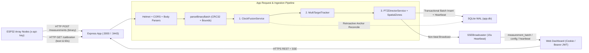
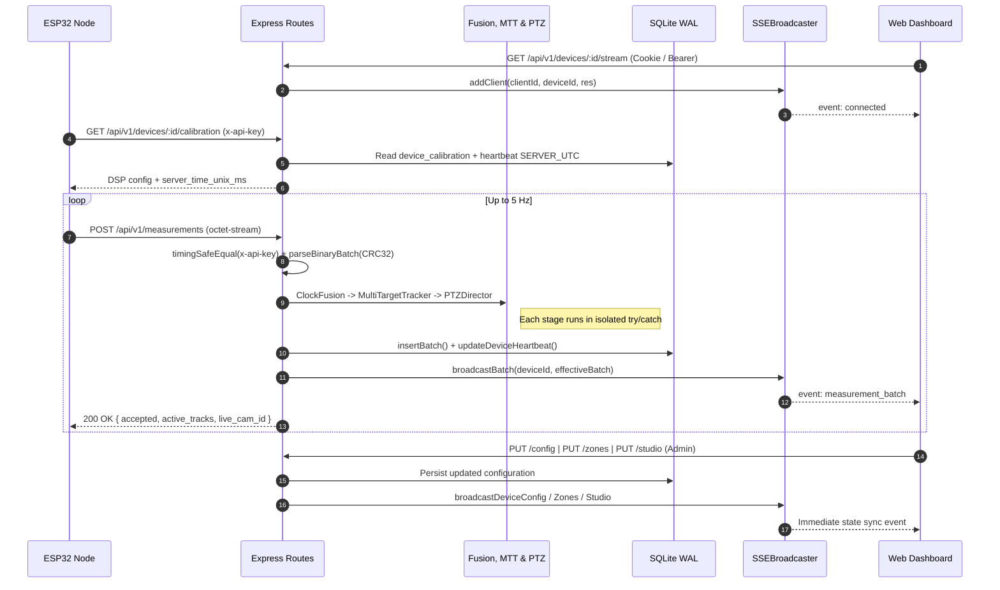

# System Architecture & Traffic Path

High-level overview of the Express network gateways, middleware pipeline, ingestion/enrichment data flow, SSE fan-out, and runtime state boundaries in `acoustic-doa-backend`.

For exact endpoint schemas, see [`API_SPECIFICATION.md`](API_SPECIFICATION.md). For binary wire framing and clock fusion equations, see [`BINARY_PROTOCOL.md`](BINARY_PROTOCOL.md).

---

## 1. Dual-Gateway Network Topology

[`bin/www`](../bin/www) validates environment configuration via `assertRuntimeEnv()`, builds the Express app via `createApp(DATABASE_PATH)` in [`app.js`](../app.js), and binds up to two network listeners:

| Gateway | Default Port | Target Clients | Auth Mechanism | Notes |
|---|---|---|---|---|
| **Device HTTP** | `PORT_HTTP` (`3000`) | ESP32 nodes on LAN, simulator, curl | `x-api-key` header | Avoids TLS handshake latency/RAM overhead on microcontrollers. |
| **Client HTTPS** | `PORT_HTTPS` (`3443`) | Browser dashboard, integrators, Swagger UI | `acoustic_session` cookie or Bearer JWT | Disabled if `DISABLE_HTTPS=true` (`ENABLE_HTTPS=false`), if `certs/server.{key,cert}` are missing, or gracefully falls back to HTTP-only on `EACCES` (e.g., Windows Hyper-V port exclusions). |

---

## 2. Express Middleware & Routing Pipeline

[`createApp()`](../app.js) wires shared services and mounts middleware in strict order:

1. **Security headers (`helmet`):** Enables `frameguard: deny` and `referrerPolicy: strict-origin-when-cross-origin`; disables `contentSecurityPolicy` so Swagger UI inline scripts work.
2. **CORS (`cors`):** Validates `Origin` against `DEFAULT_ALLOWED_ORIGINS` (`localhost` / `127.0.0.1` on ports `5173`, `3000`, `3443`, `8443`) plus comma-separated `CORS_ORIGINS`. Requests without an `Origin` header (ESP32, CLI, same-origin) are permitted; disallowed browser origins fail with `403 CORS_FORBIDDEN`.
3. **Static assets:** Serves `public/` (including `openapi.yaml`).
4. **Body parsers:**
   - `express.raw({ type: 'application/octet-stream', limit: '1mb' })` — ESP32 binary batches.
   - `express.json({ limit: '100kb' })` and `express.urlencoded({ extended: false, limit: '100kb' })` — REST control plane.
5. **Interactive docs & status routes:**
   - `/api/docs` — Swagger UI rendered from [`public/openapi.yaml`](../public/openapi.yaml) (`persistAuthorization: true`).
   - `/` and `/health` — EJS gateway status dashboard ([`views/index.ejs`](../views/index.ejs)) and JSON health probe.
6. **API v1 Router (`/api/v1`):**
   - Discovery (`GET /api/v1`)
   - Device, calibration, zone, and studio routes ([`routes/devices.js`](../routes/devices.js), [`routes/config.js`](../routes/config.js))
   - Binary measurement ingestion, latest/historical queries, stats, and tracks ([`routes/measurements.js`](../routes/measurements.js))
   - SSE real-time stream ([`routes/stream.js`](../routes/stream.js))
   - Authentication with rate limiting and user management ([`routes/auth.js`](../routes/auth.js), [`routes/users.js`](../routes/users.js))
7. **404 split & global error handler:**
   - Unknown `/api/*` paths return structured JSON `404 NOT_FOUND`; non-API browser paths render [`views/error.ejs`](../views/error.ejs).
   - Centralized handler converts `entity.parse.failed` → `400 INVALID_JSON`, `entity.too.large` → `413 PAYLOAD_TOO_LARGE`, and unexpected faults → `500` JSON envelopes.

---

## 3. High-Level Data & Traffic Path

### Component Overview

### End-to-End Ingestion & Control Sequence

---

## 4. Fault Isolation & Control-Plane Paths

- **Enrichment fault isolation:** In [`routes/measurements.js`](../routes/measurements.js), `ClockFusionService`, `MultiTargetTracker`, `PTZDirectorService`, and `sseBroadcaster.broadcastBatch` are each wrapped in separate `try/catch` blocks. If an enrichment module fails, raw measurements are still committed atomically to SQLite and acknowledged with `200 OK`.
- **SSE subscription model ([`utils/sse_broadcaster.js`](../utils/sse_broadcaster.js)):**
  - Clients subscribe per `:device_id` (`deviceId === 0` acts as a wildcard receiving all devices).
  - Events emitted: `connected`, `measurement_batch`, `device_config`, `zones_config`, `studio_config`, and `heartbeat` (every `15000 ms`).
  - Sets `X-Accel-Buffering: no` and `Cache-Control: no-cache, no-transform` to prevent reverse-proxy buffering; `GET /measurements/latest` acts as REST fallback.
- **Control-plane broadcast & cache invalidation:**
  - Updating calibration (`PUT /config`, `POST /calibrate/zero-angle`), spatial geofences (`PUT /zones`), or studio layout (`PUT /studio`) immediately fans out SSE update events after DB commit.
  - Purging measurements (`DELETE /devices/:id/measurements`) or deleting a device (`DELETE /devices/:id`) triggers `resetDeviceTrackers(deviceId)`, clearing `ClockFusionService`, `MultiTargetTracker`, and `PTZDirectorService` runtime memory together.

---

## 5. Durable vs. In-Memory State

| Component | Storage | Hydration / Lifecycle |
|---|---|---|
| Devices, calibration, measurements, users, zones, studio layout JSON | SQLite WAL ([`utils/db.js`](../utils/db.js)) | Durable across restarts; seeded if empty on boot. |
| `ClockFusionService.trackers` | In-memory `Map` + SQLite updates | Lazily hydrated from the latest `measurements` row per device; resets on hardware reboot or `resetTracker()`. |
| `MultiTargetTracker` | In-memory per-device tracker map | Transient active/coasting tracks; cleared on `resetDevice()` or server restart. |
| `PTZDirectorService.deviceRuntimeState` | In-memory camera/switching state + SQLite config | Config loaded from `device_studio_config`; live speaker bindings & switch timers are transient in memory. |
| `SSEBroadcaster.clients` & Auth `rate_limiter` | In-memory `Map`s | Per-process connections and sliding-window IP buckets (pruned periodically). |

---

## 6. Key Design Trade-Offs

| Decision | Choice | Rationale |
|---|---|---|
| **Database** | Embedded SQLite (`better-sqlite3`, WAL mode) | Zero external DB setup for local/lab deployment while allowing concurrent reads during 5 Hz batch ingestion. |
| **Gateways** | Plain HTTP (`:3000`) for ESP32 + HTTPS (`:3443`) for browsers | Eliminates TLS crypto latency/memory pressure on ESP32 nodes while protecting browser credentials and cookies over HTTPS. |
| **Live Transport** | Server-Sent Events (SSE) + REST polling fallback | Unidirectional server-to-browser telemetry maps naturally to HTTP streaming without WebSocket connection/protocol overhead; proxy-friendly with explicit `X-Accel-Buffering: no`. |
| **Auth Transport** | `HttpOnly` cookie (`acoustic_session`) + `Authorization: Bearer` | Browser sessions stay XSS-resistant via `HttpOnly` cookies, while CLI tools, Swagger UI, and API tests can pass Bearer tokens directly. |
| **Tracker & Director Execution** | Server-side stateful enrichment inside isolated `try/catch` | Guarantees all dashboard viewers observe identical Kalman tracks and live camera selections while protecting DB durability. |
