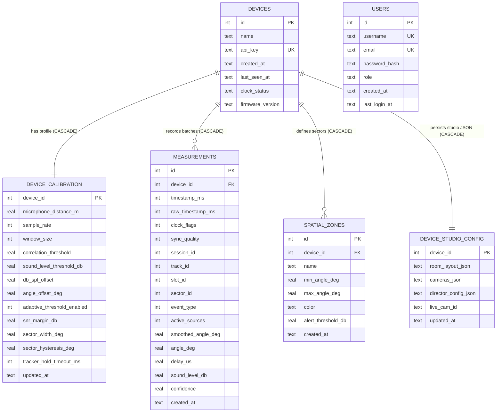

# Database Architecture & Schema Reference

Documentation for the SQLite persistence layer defined in [`db/schema.sql`](../db/schema.sql) and managed by [`utils/db.js`](../utils/db.js).

---

## 1. Engine Configuration & Connection Lifecycle

The backend uses synchronous [`better-sqlite3`](https://github.com/WiseLibs/better-sqlite3) wrapped in a singleton initializer `initDatabase(dbPath)` in [`utils/db.js`](../utils/db.js):

- **Database file path:** Configured via `DATABASE_PATH` in `.env` (defaults to `./app.db`).
- **Singleton reuse:** If `instance && instance.open` is true, subsequent calls return the active connection rather than reopening the database.
- **SQLite PRAGMAs applied on startup:**
  - `journal_mode = WAL` — Enables Write-Ahead Logging so browser dashboard queries and SSE polling read concurrently without blocking high-frequency (`<= 5 Hz`) ESP32 batch inserts.
  - `synchronous = NORMAL` — Balances write throughput with durability in WAL mode.
  - `foreign_keys = ON` — Enforces referential integrity and `ON DELETE CASCADE` across device child tables.
- **Sidecar files:** While connections are open, SQLite creates `<db>.db-wal` and `<db>.db-shm` alongside the main database file.

> [!NOTE]
> When backing up or copying a live WAL-mode database, copy all three files (`.db`, `.db-wal`, `.db-shm`) or run a SQLite checkpoint/backup API first so uncheckpointed WAL frames are not lost.

---

## 2. Entity-Relationship Model

`devices` is the root entity for all hardware telemetry and room/DSP settings. `users` is an independent access-control table.

---

## 3. Table & Column Semantics

### `devices`
Registered ESP32 microphone array nodes.

| Column | Type | Constraints / Default | Purpose |
|---|---|---|---|
| `id` | `INTEGER` | `PRIMARY KEY` | Stable device identifier (`1` for seeded node). |
| `name` | `TEXT` | `NOT NULL` | Human-readable label shown in the dashboard. |
| `api_key` | `TEXT` | `NOT NULL UNIQUE` | Shared secret checked in `x-api-key` using `crypto.timingSafeEqual`. |
| `created_at` | `TEXT` | `NOT NULL` | ISO-8601 creation timestamp. |
| `last_seen_at` | `TEXT` | Nullable | Updated on every `POST /measurements` and `GET /calibration` heartbeat; drives `online`/`offline` status (`< 120000 ms` threshold in [`DeviceService`](../utils/device_service.js)). |
| `clock_status` | `TEXT` | `DEFAULT 'UNKNOWN'` | Latest reported clock source (`MONOTONIC_UPTIME`, `SERVER_UTC`, `SNTP_UTC`, or `UNKNOWN`). |
| `firmware_version` | `TEXT` | `DEFAULT '1.0.0'` | Edge firmware version metadata. |

### `device_calibration`
Per-device DSP and edge tracker configuration polled by firmware on boot and every `60s`.

| Column | Type | Default | Purpose |
|---|---|---|---|
| `device_id` | `INTEGER` | `PRIMARY KEY REFERENCES devices(id) ON DELETE CASCADE` | 1:1 link to `devices`. |
| `microphone_distance_m` | `REAL` | `0.082` | Array spacing in meters (`0.02..0.11`). |
| `sample_rate` | `INTEGER` | `44100` | Audio ADC sample rate (`44100` or `48000` Hz). |
| `window_size` | `INTEGER` | `1024` | FFT/GCC-PHAT window size (`1024`). |
| `correlation_threshold` | `REAL` | `0.40` | Minimum normalized correlation (`0.10..1.00`). |
| `sound_level_threshold_db` | `REAL` | `55.0` | Static SPL noise floor gate (`-200..200` dB). |
| `db_spl_offset` | `REAL` | `96.5` | Microphone SPL calibration offset (`-100..200` dB). |
| `angle_offset_deg` | `REAL` | `0.0` | Zero-angle physical trim (`-180..180` deg). |
| `adaptive_threshold_enabled` | `INTEGER` | `1` | Boolean flag (`0`/`1`) for noise-floor adaptation. |
| `snr_margin_db` | `REAL` | `8.0` | Required SNR above adaptive noise floor (`0..60` dB). |
| `sector_width_deg` | `REAL` | `15.0` | Angular sector bin width (`5..90` deg). |
| `sector_hysteresis_deg` | `REAL` | `3.0` | Edge hysteresis preventing chatter (`0..15` deg, `<= sector_width_deg`). |
| `tracker_hold_timeout_ms` | `INTEGER` | `2500` | Edge tracker hold window (`200..30000` ms). |
| `updated_at` | `TEXT` | `NOT NULL` | ISO-8601 timestamp of last config update. |

### `measurements`
High-volume append/reconcile telemetry table populated transactionally by [`MeasurementService.insertBatch`](../utils/measurement_service.js).

| Column | Type | Default / Nullable | Purpose |
|---|---|---|---|
| `id` | `INTEGER` | `PRIMARY KEY AUTOINCREMENT` | Tie-breaker for simultaneous multi-source CLEAN frames sharing an identical `timestamp_ms`. |
| `device_id` | `INTEGER` | `NOT NULL`, FK `CASCADE` | Originating node. |
| `timestamp_ms` | `INTEGER` | `NOT NULL` | Harmonized, monotonically ordered Unix timestamp (ms) computed by `ClockFusionService`. |
| `raw_timestamp_ms` | `INTEGER` | Nullable | Original unadjusted batch/uptime timestamp (`baseRawMs + offsetMs`) preserved for retroactive boot-anchor reconciliation. |
| `clock_flags` | `INTEGER` | `NOT NULL` | Binary packet header clock bitmask (`0x0001`, `0x0002`, `0x0004`). |
| `sync_quality` | `INTEGER` | `NOT NULL DEFAULT 0` | `0` monotonic est., `1` server-synced, `2` SNTP locked, `3` harmonized after reconciliation. |
| `session_id` | `INTEGER` | Nullable | Monotonic boot session identifier used by `ClockFusionService.reconcileSessionHistory`. |
| `track_id` | `INTEGER` | Nullable | Multi-Target Tracker ID assigned to this detection (`null` on orphaned/leave rows). |
| `slot_id` | `INTEGER` | `NOT NULL DEFAULT 0` | Display/hardware slot index (`0..2` on server tracker; hardware slot byte in packet). |
| `sector_id` | `INTEGER` | `NOT NULL DEFAULT 0` | Hardware sector index (`0..255`; `255` = `INVALID_SECTOR_ID`). |
| `event_type` | `INTEGER` | `NOT NULL DEFAULT 1` | `1` `ENTER`, `2` `MOVE`, `3` `HEARTBEAT`, `4` `LEAVE`. Note: `LEAVE` (`4`) rows are excluded from `getStats()` SPL/histogram aggregations and zero-angle auto-trim. |
| `active_sources` | `INTEGER` | `NOT NULL DEFAULT 1` | Simultaneous sources detected in frame. |
| `smoothed_angle_deg` | `REAL` | Nullable | Kalman-filtered azimuth estimate from `MultiTargetTracker` (falls back to `angle_deg` when unsmoothed). |
| `angle_deg` | `REAL` | `NOT NULL` | Raw DOA azimuth in `[-180.0, 180.0]` deg. |
| `delay_us` | `REAL` | `NOT NULL` | GCC-PHAT / wavefront time-of-flight delay in microseconds. |
| `sound_level_db` | `REAL` | `NOT NULL` | Estimated SPL in dB (`-200..200`). |
| `confidence` | `REAL` | `NOT NULL` | Normalized correlation confidence (`0.0..1.0`). |
| `created_at` | `TEXT` | `NOT NULL` | Server ISO-8601 ingestion timestamp. |

> [!IMPORTANT]
> **Retroactive `timestamp_ms` updates:** `ClockFusionService.reconcileSessionHistory()` updates existing rows in place (`SET timestamp_ms = raw_timestamp_ms + ?, sync_quality = ?`) when `device_id`, `session_id`, `sync_quality IN (0, 3)`, and `raw_timestamp_ms < 1704067200000` match a tighter lower-envelope boot anchor or monotonic-to-UTC lock.

### `spatial_zones`
Named angular geofences evaluated by the PTZ Director and dashboard radar UI. Up to `32` zones per device are validated by [`SpatialZoneService`](../utils/spatial_zone_service.js).

| Column | Type | Default | Purpose |
|---|---|---|---|
| `id` | `INTEGER` | `PRIMARY KEY AUTOINCREMENT` | Zone row ID (regenerated on full-replace `PUT /zones`). |
| `device_id` | `INTEGER` | `NOT NULL`, FK `CASCADE` | Owning device. |
| `name` | `TEXT` | `NOT NULL` | Zone label (`1..64` chars). |
| `min_angle_deg` | `REAL` | `NOT NULL` | Start azimuth (`-180..+180`). |
| `max_angle_deg` | `REAL` | `NOT NULL` | End azimuth (`-180..+180`, `!= min_angle_deg`). If `min_angle_deg > max_angle_deg`, `min > 0 && max < 0` is required to represent a wrap-around sector across the `±180°` South seam. |
| `color` | `TEXT` | `NOT NULL DEFAULT '#10b981'` | 3- or 6-digit hex color. |
| `alert_threshold_db` | `REAL` | `DEFAULT 75.0` | Validated alert threshold (`30..130` dB). |
| `created_at` | `TEXT` | `NOT NULL` | ISO-8601 timestamp. |

### `device_studio_config`
Stores virtual studio room layout, 1–3 camera placements, and Schmitt-trigger director tuning as JSON documents alongside `live_cam_id`:

| Column | Structure |
|---|---|
| `room_layout_json` | `{ tableShape: "oval" \| "round" \| "ushape" \| "hollow_square", tableWidthRatio, tableHeightRatio, seatCount, customChairs?: [{ id, xRatio, yRatio }] }` |
| `cameras_json` | Array of 1–3 cameras: `{ id, name, role: "front" \| "rear" \| "side", xRatio, yRatio, restingPanDeg, currentPanDeg, targetPanDeg, fovDeg, color, isLive, assignedTargetSlot, isLockedOnSubject, lastTargetPos }` |
| `director_config_json` | `{ slewSpeedDegPerSec, instantCut, holdTimeMs, confirmTimeMs, hysteresisMarginPercent }` |
| `live_cam_id` | Active on-air camera ID (defaults to `'cam-front'`). |

Storing these UI/director configs as validated JSON blobs keeps `getStudioConfig()` / `updateStudioConfig()` single-row atomic (`ON CONFLICT(device_id) DO UPDATE`) without extra join tables.

### `users`
Dashboard authentication and RBAC table:

| Column | Type | Constraints | Notes |
|---|---|---|---|
| `id` | `INTEGER` | `PRIMARY KEY AUTOINCREMENT` | Referenced inside signed JWT payloads and re-checked live on every authenticated request. |
| `username` | `TEXT` | `NOT NULL UNIQUE` | Stored lowercased (`3..32` chars `[a-zA-Z0-9_.-]`). |
| `email` | `TEXT` | `NOT NULL UNIQUE` | Stored lowercased (`<= 254` chars). |
| `password_hash` | `TEXT` | `NOT NULL` | `bcryptjs` hash (`12` rounds in runtime, `10` under Vitest/test). |
| `role` | `TEXT` | `NOT NULL CHECK(role IN ('admin', 'viewer'))` | Controls admin endpoints (`devices`, `config`, `zones`, `studio`, `users`). |
| `created_at` | `TEXT` | `NOT NULL` | ISO-8601 creation timestamp. |
| `last_login_at` | `TEXT` | Nullable | Updated on successful `POST /api/v1/auth/login`. |

---

## 4. Indexes & Query Access Paths

| Index | Columns | Primary Consumer |
|---|---|---|
| `idx_measurements_device_time` | `(device_id, timestamp_ms DESC, id DESC)` | `getLatestMeasurements()`, `queryMeasurements()`, `calibrateZeroAngle()`, `ClockFusionService._hydrateTrackerFromDb()`, `getStats()` |
| `idx_measurements_time` | `(timestamp_ms DESC, id DESC)` | Cross-device chronological lookups |
| `idx_measurements_session` | `(device_id, session_id)` | `ClockFusionService.reconcileSessionHistory()` updates |
| `idx_measurements_track` | `(device_id, track_id)` | Track-scoped inspection/filtering |
| `idx_spatial_zones_device` | `(device_id)` | `SpatialZoneService.getZones()` and `updateZones()` |
| `idx_users_username` | `(username)` | Fast login and `resolveActiveUser()` lookups |

---

## 5. Idempotent Migrations & Bootstrap Seeding

On every startup, [`initDatabase()`](../utils/db.js) applies:

1. **Base DDL:** Executes [`db/schema.sql`](../db/schema.sql) (`CREATE TABLE IF NOT EXISTS` / `CREATE INDEX IF NOT EXISTS`).
2. **Additive column migrations:** Inspects `PRAGMA table_info('measurements')` and `PRAGMA table_info('device_calibration')` and runs idempotent `ALTER TABLE ... ADD COLUMN` statements (backfilling `raw_timestamp_ms = timestamp_ms` and `smoothed_angle_deg = angle_deg` for legacy rows) plus index rebuilds.
3. **Bootstrap seeding (when tables are empty):**
   - **Device `#1` (`ESP32 DOA Array #1`):** Created with `DEFAULT_DEVICE_API_KEY` and default `device_calibration` row if no device `id = 1` exists.
   - **Default Spatial Zones (Device `#1`):** Seeds 4 zones (`Podium / Stage` `-30..30`, `Audience Left` `-90..-30`, `Audience Right` `30..90`, `Rear Gallery` `150..180`) if count is `0`.
   - **Default Studio Config (Device `#1`):** Seeds `DEFAULT_ROOM_LAYOUT`, `DEFAULT_VIRTUAL_CAMERAS` (`cam-front`, `cam-rear`, `cam-side`), and `DEFAULT_DIRECTOR_CONFIG`.
   - **Initial `admin` & `viewer` accounts:** Seeded when zero accounts exist for each role, reading `DEFAULT_ADMIN_*` and `DEFAULT_VIEWER_*` environment variables.

---

## 6. Storage Lifecycle, Retention & Cleanup

- **No automatic TTL pruning:** `measurements` grows continuously with ingested ESP32 batches until purged manually.
- **Explicit data purge:** `DELETE /api/v1/devices/:device_id/measurements` deletes all rows for a device and immediately calls `resetDeviceTrackers(deviceId)` in [`routes/devices.js`](../routes/devices.js) so in-memory clock fusion, tracker, and director caches stay synchronized with the database.
- **Cascade deletion:** `DELETE /api/v1/devices/:device_id` (blocked if only one device remains) cascades across `device_calibration`, `measurements`, `spatial_zones`, and `device_studio_config` and clears in-memory trackers.
